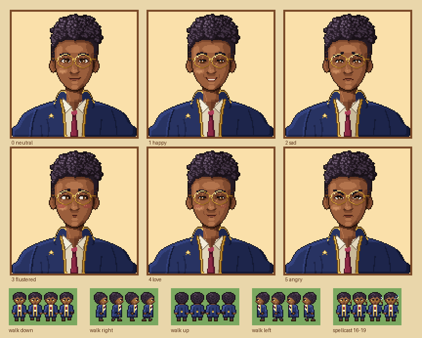

# Wizarding School: Auden Fairweather

A romanceable male NPC for the wizarding-school Stardew Valley mod, drawn to match the existing character's art style
(128×128 HD portraits and a 16×32 overworld sprite).



## Who he is

**Auden Fairweather**, 27, is the school's astronomy and divination tutor. He lives in the observatory at the top of the
tower. He's bookish, sincere and dryly funny, hopeless before his first coffee, and overprepared for everything except
being liked back. His round gold spectacles are self-charmed so he can see starlight in daylight. It's a brilliant idea
and it gives him a terrible headache.

He's a counterpoint to the existing character: that one is rugged and roguish in earthy browns and plum, and Auden is
tidy and scholarly in midnight navy and gold.

| | |
|---|---|
| Birthday | Winter 11 |
| Loves | Coffee, Prismatic Shard, Fairy Rose, Crystal Fruit, Diamond |
| Likes | Earth Crystal, Frozen Tear, Fire Quartz, Green Tea, Blueberry Tart, Quartz |
| Dislikes | Sap, Clay |
| Hates | Trash, Joja Cola, Holly |

## Files

| File | Size | Notes |
|---|---|---|
| `assets/Auden/Auden_portraits_HD.png` | 256×384 | Six 128×128 portraits, two per row, same format as the reference character |
| `assets/Auden/Auden_portraits.png` | 128×192 | Vanilla 64×64 fallback, auto-downscaled from the HD sheet |
| `assets/Auden/Auden_sprite.png` | 64×160 | 16×32 frames: walk down / right / up / left, plus a spellcast row |
| `assets/Auden/dialogue.json` | | Intro, daily lines, heart-gated lines, gift and bouquet reactions |
| `content.json`, `manifest.json` | | Content Patcher pack (Stardew 1.6 `Data/Characters` format) |

Portrait order follows the vanilla `$` codes, so dialogue can use them directly:

| Index | Code | Expression |
|---|---|---|
| 0 | `$0` | neutral (soft smile) |
| 1 | `$h` | happy |
| 2 | `$s` | sad |
| 3 | `$u` | flustered, glancing away (unique) |
| 4 | `$l` | love (blushing) |
| 5 | `$a` | angry / stern |

**Spellcast animation:** sprite frames 16–19 (row 5) raise a wand with sparks that build up over the four frames. Use it in
events like this:

```
animate {{ModId}}_Auden false true 150 16 17 18 19
```

## Regenerating the art

All the art is generated by scripts (Python 3 with Pillow and NumPy), so you can change colours, expressions or details
and rebuild:

```
python3 tools/auden_sprite.py     # sprite sheet + previews/Auden_sprite_x8.png
python3 tools/auden_portrait.py   # HD + 64px portrait sheets + previews
python3 tools/preview.py          # previews/Auden_overview.png
```

Palettes are at the top of each script (`PAL` in the sprite script, `RAMPS` in the portrait script). Expressions are
small pixel stamps (`EYES`, `MOUTHS`) plus brow curves (`BROWS`), combined in `FACES`.

## Still to do before release

- **Home location:** `content.json` puts him in `WizardHouse` as a placeholder. Point it at the school's observatory map,
  and use a tile he can actually stand on.
- **HD portraits:** the pack registers the 128px sheet with HD Portraits (`Mods/HDPortraits`). If your other character
  uses a different framework, copy its setup instead.
- **Romance content:** schedule, heart events, marriage dialogue and a spouse room aren't written yet.
- **Not yet tested in-game.** Load it with SMAPI and Content Patcher and run `patch summary` to check the patches apply.
